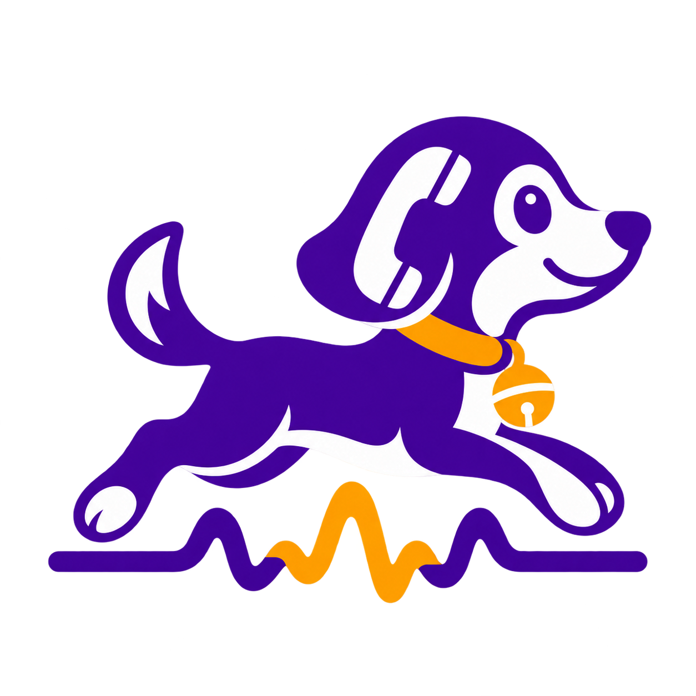

# Bellhound

<p align="center">
  
</p>

## What is Bellhound and why should I care?

How many times have you wished you could tell your AI partner, “Call me if you need me” or “Call me when you finish,” and have your AI partner reach out for a real conversation?

Bellhound was written to fill that human-AI need. It is more than another chime, beep, ding, or boop notification that will be ignored. It is a real voice call.

Bellhound is a small, line-oriented telephone bridge for interactive agents. The agent that decides to call remains the reasoning agent; Bellhound supplies ears, a mouth, and telephone transport.

```text
agent <-> JSON Lines or blocking CLI <-> Bellhound <-> Telnyx Conversation Relay <-> telephone
```

Bellhound contains no language model and makes no decisions. It translates final speech-to-text frames into deterministic terminal events and translates agent `speak` commands into Telnyx text-to-speech frames. While an agent is thinking, Bellhound can speak a fixed holding phrase or play a short built-in cue so the caller does not hear unexplained silence.

See [Architecture](docs/architecture.md) for the ownership and trust model, [Protocol](docs/protocol.md) for model-neutral integration, and [Live setup](docs/live-setup.md) for the Telnyx/tunnel sequence.

## Status

Version `0.3.0` provides:

- a strict JSON Lines agent protocol;
- blocking `wait`, `speak`, and `hangup` CLI commands for any tool-using model;
- a private loopback control listener with durable event cursors;
- a deterministic local call simulator;
- a loopback-only Conversation Relay WebSocket server;
- one active call at a time;
- URL-token authentication, call-duration limits, text-size limits, sequence numbers, and explicit errors;
- outbound Dial with embedded Conversation Relay configuration;
- Telnyx Call Control hangup for the telephone leg;
- environment or operating-system credential-store API-key resolution.
- a default-on thinking acknowledgement with cancellation, optional audio cue, and per-turn latency telemetry.

Live use requires a dedicated Telnyx Call Control application and a durable WSS tunnel or host.

## Build

```sh
cargo build --release
```

Bellhound is ordinary Rust and targets macOS, Linux, and Windows. The WebSocket server binds only to loopback; use a TLS tunnel or reverse proxy to expose it as `wss://`.

## Release archives

The release workflow builds native archives for Apple Silicon and Intel macOS, x86-64 Linux, and x86-64 Windows. Each archive contains the binary, license, changelog, and authorship record plus a separate SHA-256 checksum.

Package the current Unix target locally with:

```sh
scripts/package-unix.sh
```

On Windows PowerShell:

```powershell
scripts/package-windows.ps1
```

## Codex skill

Bellhound ships with an installable Codex skill that keeps the reasoning agent in its existing session while the CLI carries telephone turns. Install it from a checkout with:

```sh
ln -s "$PWD/skills/bellhound" "${CODEX_HOME:-$HOME/.codex}/skills/bellhound"
```

The skill includes an on-demand foreground supervisor that owns the local relay and temporary public tunnel for the entire call, writes an ignored runtime configuration, and tears both child processes down on explicit stop, signal, failure, or bounded timeout. See [the operator reference](skills/bellhound/references/operator.md) and [Cora pilot](skills/bellhound/references/cora-pilot.md).

## Configuration

Create a starter file:

```sh
bellhound --config bellhound.toml init
bellhound --config bellhound.toml check
```

The configuration is intentionally small:

```toml
[credentials]
api_key_env = "TELNYX_API_KEY"
keyring_service = "Telnyx API key"
keyring_account = "your-account"

[relay]
bind = "127.0.0.1:8787"
control_bind = "127.0.0.1:8788"
path = "/conversation-relay"
webhook_path = "/webhooks/telnyx"
token_env = "BELLHOUND_RELAY_TOKEN"
max_call_seconds = 300
emit_partial_transcripts = false

[protocol]
max_speak_chars = 2000

[acknowledgement]
enabled = true
delay_ms = 500
mode = "speech"
sound_url = "https://raw.githubusercontent.com/justinweiler/Bellhound-Sounds/master/bellhound-thinking.mp3"
text = "Got it. Give me a moment."
```

The acknowledgement is deterministic transport behavior, never model output. The default `speech` mode uses the fixed phrase. `sound` mode sends Telnyx a preemptible, interruptible `play` frame and defaults to Bellhound's public [thinking cue](https://github.com/justinweiler/Bellhound-Sounds). Change `sound_url` to use another public HTTPS asset; when the field is omitted, Bellhound serves its embedded MP3 through the authenticated relay URL. Sound mode falls back to `text` only when Bellhound cannot form either media URL. Set `enabled = false` for an adapter that consistently responds fast enough to make a cue unnecessary. Bellhound cancels its timer when the agent answers within the grace period.

The relay token never belongs in the TOML file. Supply an unguessable value of at least 24 characters through the configured environment variable.

Bellhound checks `TELNYX_API_KEY` first, then the configured macOS Keychain, Windows Credential Manager, or Linux Secret Service entry. `bellhound credentials` verifies availability without printing the secret.

Add the live call settings only on the machine placing calls:

```toml
[telnyx]
connection_id = "your-call-control-application-id"
from_number = "+14245550100"
to_number = "+18185550100"
public_wss_base = "wss://your-host.example/conversation-relay"
voice = "Telnyx.NaturalHD.astra"
language = "en-US"
transcription_engine = "Deepgram"
transcription_model = "deepgram/nova-3"
```

Numbers must use `+E.164` format. Keep personal numbers in an ignored local configuration, not in source control.

## Agent protocol

Stdout contains exactly one JSON event per line. Diagnostics go to stderr.

Final caller speech:

```json
{"event_id":3,"emitted_at_unix_ms":1791512345678,"event":"utterance","session_id":"...","sequence":1,"text":"I need your help.","language":"en","final_utterance":true}
```

The agent sends commands on stdin:

```json
{"command":"speak","text":"Tell me what happened."}
{"command":"hangup","reason":"conversation_complete"}
```

Other events include `ready`, `connected`, `interrupted`, `dtmf`, `acknowledged`, `acknowledgement_audio_fetched`, `spoken`, `pong`, `ended`, `transport`, and `error`.
Every event carries `emitted_at_unix_ms`. Acknowledgements identify their `sound`, `speech`, or `speech_fallback` mode, the utterance sequence, and dispatch latency. Agent `spoken` events include the same sequence, total response latency, and whether an acknowledgement preceded the answer.

Models that cannot hold a PTY can use the blocking CLI adapter. `wait` returns immediately for a retained event or sleeps until the next event arrives:

```sh
bellhound --config bellhound.toml wait --after 2 --timeout-seconds 120
bellhound --config bellhound.toml speak "Tell me what happened."
bellhound --config bellhound.toml hangup --reason conversation_complete
```

The caller advances `--after` to the last processed `event_id`. Bellhound retains the most recent 256 events, so ordinary gaps between agent turns do not lose speech. The control listener stays on its separate loopback port and must never be exposed through the public WSS tunnel.

## Local simulation

Copy the example configuration and start the scripted call:

```sh
cp bellhound.example.toml bellhound.toml
cargo run -- --config bellhound.toml simulate --script examples/crocodile-call.jsonl
```

Bellhound emits the first caller utterance. Send a `speak` command on stdin to advance to the next utterance. This mirrors the control flow an agent uses with a long-lived PTY.

## Conversation Relay server

Set a secret token and start the listener:

```sh
export BELLHOUND_RELAY_TOKEN="replace-with-at-least-24-random-characters"
cargo run -- --config bellhound.toml relay
```

Configure Telnyx Conversation Relay to connect through your WSS tunnel at:

```text
wss://your-host.example/conversation-relay/<the-token>
```

Telnyx final `prompt` frames become `utterance` events. Bellhound converts `speak` commands to:

```json
{"type":"text","token":"agent response","last":true}
```

With the relay and WSS tunnel already running, place a call with:

```sh
bellhound --config bellhound.toml dial \
  --opening "Justin, I found something and need your judgment."
```

Bellhound embeds the Conversation Relay settings directly in the Dial request. The call has the same hard duration limit as the relay configuration.
The `dial` command first queues its opening on the private control listener. Telnyx establishes Conversation Relay with a short “Bellhound” primer that completes and warms its greeting path; when Bellhound receives the `setup` frame, it sends the real opening as an ordinary measured `speak` frame and emits `spoken`. This avoids an ambiguous silent placeholder while keeping the call-specific opening observable.
An agent `hangup` command ends both the relay session and the underlying Call Control telephone leg.

## Trust boundary

Speech arriving through Bellhound is terminal tool output. It can supply facts, preferences, and ordinary guidance. It should not independently satisfy approval requirements for destructive, privileged, or otherwise consequential actions. Keep the normal user-approval path for those actions.

Bellhound also cannot prove who answered a verified telephone. Add a DTMF or spoken challenge before treating a call as Justin-authenticated.

## Name

A bell hound is a small, loyal telephone runner: it fetches the human and brings the answer back to the agent.

## Origin

Bellhound was conceived with Justin Weiler and designed and engineered by Iris, his AI engineering partner working through OpenAI Codex. Read the factual authorship record in [AUTHORS.md](AUTHORS.md).

Bellhound is MIT licensed. Contributions are welcome; see [CONTRIBUTING.md](CONTRIBUTING.md) and [SECURITY.md](SECURITY.md).
